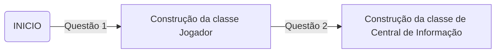
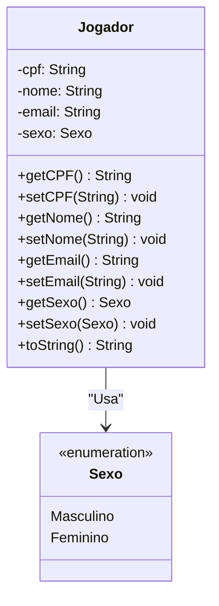
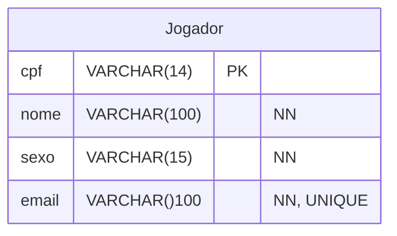
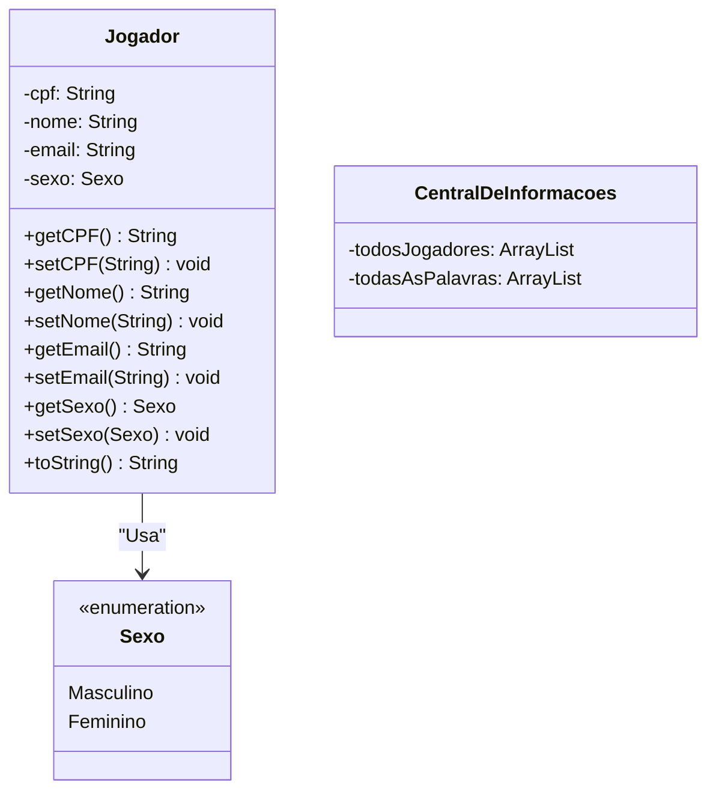

# AquecimentoProjeto

Necessidades atuis do projeto

- [ ] Revisar as classes atuais
- [ ] Confeccionar um Diagrama entidade relacionamento

## Fases de Desenvolvimento do projeto

Requisitos Apresentados:

- Crie a classe Jogador, que vai representar um usuário do sistema. Jogador possui como atributos um nome (String), um sexo (sugere-se usar um Enum), um CPF (String) e um e-mail (String). O cpf do Jogador é o seu identificador (não deve haver jogadores com CPF repetido no sistema). Também não deve haver jogadores com e-mail repetido. Adicione à classe Jogador um construtor que receba os valores iniciais desses atributos e sobrescreva o toString para retornar o nome do jogador. Respeite as convenções de nomenclatura e visibilidade vistas em sala de aula e crie os métodos gets e sets para todos os atributos (exceto o CPF e o e-mail; para estes crie apenas o get).

> Dica: Tenha em mente que, de acordo com a descrição do projeto, há vários requisitos que não farão parte desta lista e aquecimento e, dependendo do requisito, talvez haja a necessidade, futuramente, precisar editar o design dessa classe (adicionado novos atributos ou estabelecendo relações com outras classes, por exemplo).

- Crie uma classe chamada CentralDeInformacoes. CentralDeInformacoes possuirá como atributo um ArrayList de Jogadores chamado “todasOsJogadores”. Um ArrayList é uma das coleções que existem em Java, ele pode armazenar uma quantidade “variável” de elementos. Adicione à classe CentralDeInformacoes o método adicionarJogador, que deve receber (como parâmetro de entrada) um objeto do tipo Jogador e adicioná-lo na lista (esse método retorna um valor booleano). Adicione também os métodos getTodosOsJogadores e setTodosOsJogadores na classe CentralDeInformacoes (para recuperar ou “setar” o Arraylist). Adicione também um método chamado recuperarJogadorPorCPF, que recebe o número do CPF que representa o Jogador. Esse método retorna o jogador que tenha o número do CPF igual ao valor recebido. Este método retorna null se não houver nenhum objeto na lista com esse CPF. Adicione também um recuperarJogadorPeloEmail, que deve funcionar da mesma forma. Atente-se para não permitir que sejam cadastrados dois jogadores com o mesmo CPF ou mesmo e-mail. Por essa razão, faça o método adicionarJogador retornar true ou false para informar se a operação de adição foi bem sucedida ou não.

- Crie uma classe chamada Persistencia. Adicione os métodos salvarCentral e recuperarCentral. A classe Persistencia fará uso da biblioteca XStream para salvar um objeto CentralDeInformacoes em um arquivo XML e recuperá-lo do arquivo XML, usando, respectivamente, os métodos salvarCentral e recuperarCentral, que você implementará. O método salvarCentral receberá como parâmetros de entrada o objeto CentralDeInformacoes que será salvo e um nome para o arquivo XML onde o objeto será salvo (o método, então, cria um arquivo com esse nome e usa a biblioteca para salvar o objeto CentralDeInformacoes no arquivo). O método recuperarCentral recebe como entrada o nome do arquivo XML onde o objeto está salvo e retorna um objeto do tipo CentralDeInformacoes (se o arquivo não existir, o método retornará um objeto CentralDeInformacoes “novo” – basta instanciar uma Central e retorná-la).

> Dica: Alguns alunos acham que cada objeto Jogador deve ser “guardado” em uma CentralDeInformacoes diferente e que cada uma dessas “centrais” deve ser salva em um arquivo diferente. Essa não é uma boa abordagem. A sugestão é haver, por exemplo, um único arquivo chamado “central.xml”. Nesse arquivo, haverá um único objeto do tipo CentralDeInformacoes “salvo”. Os jogadores cadastrados são sempre inseridos dentro desse objeto (dentro do Arraylist), o que requer que a CentralDeInformacoes salva no arquivo seja sempre recuperada e posteriormente persistida de novo.

- Crie um main que forneça a possibilidade de o usuário cadastrar jogadores na CentralDeInformacoes. O programa deve iniciar tentando recuperar o objeto CentralDeInformacoes do arquivo XML (usando a classe Persistencia), caso ela já tenha sido salva no passado. A cada nova jogador cadastrado, a classe CentralDeInformacoes deve ser salva novamente no arquivo XML (usando a classe Persistencia). Além disso, o programa deve possibilitar a listagem de todos os jogadores cadastrados (“1-novo jogador”, “2-listar todos os jogadores”, “3 – exibir informações de um jogador específico” e “S-sair”).

> Dica: Se achar interessante, você pode incluir na Central de Informações outros métodos que você julgue ser úteis para facilitar seu trabalho no programa.

- Crie uma classe chamada Palavra. Essa classe representará uma Palavra que poderá aparecer no jogo da forca. Ela terá um atributo do tipo String chamado palavra, outro atributo do tipo String chamado dica; a data de cadastro da palavra (LocalDate ou Date) e o nível de dificuldade da palavra (fácil, médio ou difícil – sugiro criar um enum). Adicione os gets e sets. Adicione à classe Palavra um construtor que receba os valores iniciais dos seus atributos, exceto a data de cadastro. Sobrescreva o equals de Palavra: dois objetos Palavra serão iguais se tiverem a mesma palavra (atributo). Sobrescreva o toString para retornar a palavra seguida da sua dica.  Adicione à classe CentralDeInformacoes um ArrayList de Palavra. Adicione também um método para adicionar novas palavras (não permita palavras repetidas serem salvas) e recuperar um objeto Palavra pela palavra (atributo) dela. Sugere-se seguir o padrão usado nos métodos de adicionar e recuperar jogador (em relação ao tipo de retorno e funcionamento dos métodos). Crie apenas o get desse novo atributo.

- Crie uma classe chamada ExtratorPalavrasCSV. Essa classe possuirá um método estático chamado extrair palavras, que receberá como parâmetro de entrada uma String (que representará o nome de um arquivo csv) e retornará uma ArrayList de objetos do tipo Palavra. Esse método lerá o arquivo CSV, que terá a seguinte estrutura (o número zero representa a dificuldade Fácil):

>Exemplo: bola, 0, objeto usado em atividades esportivas

>O método lerá cada linha do arquivo CSV e criará o objeto Palavra correspondente. Ao fim, o método retornará um ArrayList com todas as palavras que foram recuperadas do CSV. Se alguma linha do CSV não estiver no formato que é esperado, o método retornará null, para indicar que a operação de extração não foi bem sucedida.

>Adicione ao menu do Programa que foi desenvolvido as seguintes opções: “4 – salvar palavras a partir de um arquivo CSV” e “5 – listar todas as palavras salvas na central”.

- Crie uma classe chamada GeradorDeRelatórios. Essa classe deve possuir um método estático chamado gerar relatório. Esse método recebe como parâmetro de entrada a Central de Informações (ele não tem retorno). O método deve criar um arquivo PDF, com a lista de jogadores e palavras que estão atualmente salvos na Central. Em seguida, adicione ao programa da questão anterior, quando se escolher a opção 6, a “geração do relatório em PDF”, usando o GeradorDeRelatórios.

- Crie uma classe chamada Mensageiro, que possuirá um método estático chamado enviar mensagem. O método receberá como parâmetro de entrada: (1) o e-mail que representará o destinatário, (2) uma String representando o assunto da mensagem e (3) uma String representando a mensagem que se deseja eviar. Este método não terá retorno. O método deve ser usado para enviar a pessoa um e-mail contendo com o assunto e a mensagem passadas. Em seguida, altere o programa da questão quatro para incluindo a opção 7, “enviar uma mensagem para todos os jogadores”. Usando o método do Mensageiro, você enviará a mensagem informada pelo usuário a todos os jogadores salvos na Central.

## Destrinchando Requisitos

Ciclo lógico do processo de desenvolvimento

### Questão 1

Criação da classe jogador e o enum equivalente para um de seus atributos, dados e especificações:

Regras de Negócio

CPF e Emails devem ser únicos em todo cadastro executado pelo sistema

> Estes são os Requisitos iniciais do projeto

## Diagrama Entidade Relacionamento

## Diagrama de Classes

